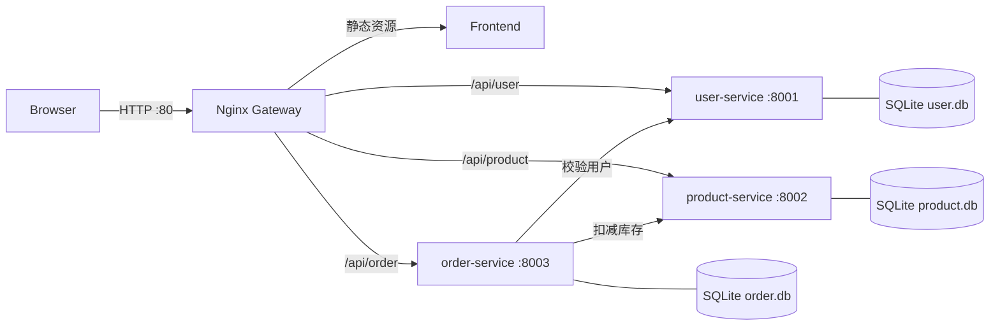
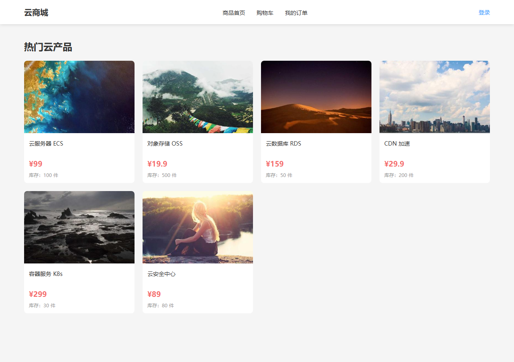
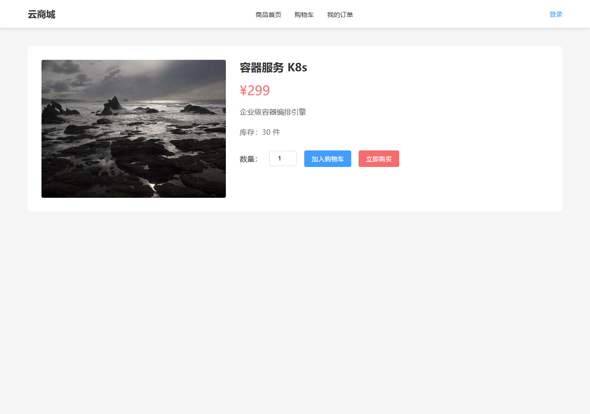
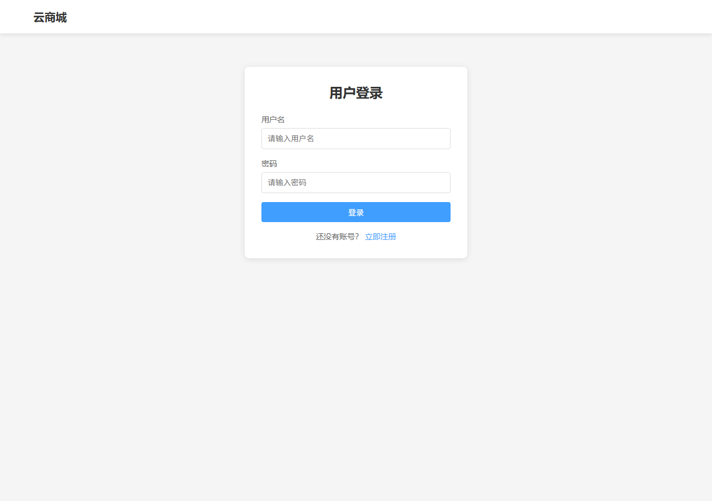

# 云原生微服务电商系统 · Cloud-Native Mall

> 基于 Flask + SQLite + Nginx + Docker Compose 的云原生微服务实践项目：三个独立业务服务、一个统一网关、一套容器化编排。


## 1. 项目简介

一个按业务边界拆分的轻量级电商系统：**用户、商品、订单**三个独立 Flask 服务，各自持有 SQLite 数据库；**Nginx** 作为统一入口，同时托管静态前端并反向代理三个 API；**Docker Compose** 一条命令完成构建、编排、健康检查与启动。

项目的重点不在业务复杂度，而在于完整演示一套云原生应用落地流程：

- 微服务拆分与独立数据存储
- 容器网络内的服务发现与跨服务调用
- 健康检查驱动的启动顺序控制
- 数据卷持久化与运行产物隔离
- 统一 API 响应规范与密码哈希存储

## 2. 系统架构



一次下单请求的链路：

1. 浏览器向网关 `POST /api/order/create`
2. 订单服务调用用户服务校验用户是否存在
3. 订单服务调用商品服务扣减库存（条件更新，防止超卖）
4. 订单服务拉取商品价格、计算总价并写入订单库

## 3. 界面预览

<p align="center">
  
  
</p>
<p align="center">
  
</p>

## 4. 技术栈

| 层次 | 技术 | 说明 |
|---|---|---|
| 后端 | Python 3.10、Flask 2.3 | 三个独立 REST 服务 |
| 数据库 | SQLite 3 | 每个服务独立数据库文件 |
| 网关 | Nginx | 静态资源托管 + 反向代理 |
| 部署 | Docker、Docker Compose v2 | 一键构建与编排 |
| 前端 | 原生 HTML / CSS / JavaScript | 无构建步骤，直接由 Nginx 托管 |
| 安全 | Werkzeug 加盐哈希 | 密码哈希存储，不落明文 |

## 5. 目录结构

```text
cloud-native-mall/
├── frontend/                 # 静态前端（由网关托管）
│   ├── index.html            # 商品首页
│   ├── login.html            # 登录 / 注册
│   ├── product.html          # 商品详情
│   ├── cart.html             # 购物车
│   ├── orders.html           # 我的订单
│   └── assets/
│       ├── style.css
│       └── images/1.jpg ~ 6.jpg
├── gateway/
│   ├── Dockerfile
│   └── nginx.conf            # 反向代理与静态资源配置
├── user-service/             # 用户服务 :8001
│   ├── app.py
│   ├── Dockerfile
│   ├── requirements.txt
│   ├── .dockerignore
│   └── data/.gitkeep
├── product-service/          # 商品服务 :8002
├── order-service/            # 订单服务 :8003
├── docs/screenshots/         # README 界面预览截图
├── docker-compose.yml        # 服务编排
├── .github/workflows/ci.yml  # CI：Python 语法检查 + Compose 校验
├── .dockerignore
├── .gitignore
├── .editorconfig
├── LICENSE
└── README.md
```

## 6. 快速开始

### 6.1 环境要求

- Docker Desktop（Windows / macOS）或 Docker Engine + Compose v2（Linux）
- 本机 `80`、`8001`、`8002`、`8003` 端口未被占用

### 6.2 一键启动

```bash
docker compose up -d --build
```

首次启动会拉取基础镜像、安装依赖、初始化数据库并写入种子数据，通常需要几分钟。

### 6.3 检查状态

```bash
docker compose ps
```

预期四个服务均为 `Up`，其中三个 Python 服务显示 `healthy`：

```text
user-service       Up (healthy)
product-service    Up (healthy)
order-service      Up (healthy)
gateway            Up
```

### 6.4 访问地址

| 入口 | 地址 |
|---|---|
| 商城首页 | <http://localhost> |
| 用户服务 | <http://localhost:8001> |
| 商品服务 | <http://localhost:8002> |
| 订单服务 | <http://localhost:8003> |

### 6.5 测试账号

- 用户名：`test`
- 密码：`123456`

用户服务首次启动自动创建 `users` 表并写入该账号；商品服务自动写入 6 条示例商品；订单服务自动创建 `orders` 表。

## 7. 接口一览

所有接口统一返回 `{ "code": 0, "msg": "success", "data": ... }`，`code != 0` 表示业务错误。

| 服务 | 方法 | 路径 | 说明 |
|---|---|---|---|
| user | POST | `/api/user/register` | 注册（用户名 ≥ 3 位，密码 ≥ 6 位） |
| user | POST | `/api/user/login` | 登录 |
| user | GET | `/api/user/info/<id>` | 查询用户信息 |
| product | GET | `/api/product/list?page=1&size=10` | 商品分页列表 |
| product | GET | `/api/product/info/<id>` | 商品详情 |
| product | POST | `/api/product/deduct` | 扣减库存 |
| order | POST | `/api/order/create` | 创建订单 |
| order | GET | `/api/order/list/<user_id>` | 用户订单列表 |
| 全部 | GET | `/health` | 健康检查 |

## 8. 设计要点

**按业务边界拆分，独立数据库。** 用户、商品、订单各自持有 SQLite 文件，服务之间只通过 HTTP 交互，不共享表结构，避免微服务退化为“分布式单体”。

**容器内服务发现。** 订单服务通过环境变量获取下游地址，容器网络内直接使用 Compose 服务名：

```yaml
environment:
  - USER_SERVICE_URL=http://user-service:8001
  - PRODUCT_SERVICE_URL=http://product-service:8002
```

本地直接运行 Python 时回退到 `127.0.0.1`，两种运行方式共用同一份代码。

**健康检查控制启动顺序。** 镜像基于 `python:3.10-slim`，不含 `curl`，因此健康检查使用 Python 标准库发起请求；Compose 通过 `depends_on.condition: service_healthy` 等待依赖服务就绪后再启动网关和订单服务。

**库存扣减防超卖。** 扣减使用带条件的原子更新，并以 `rowcount` 判断是否成功，避免“先查后改”的并发窗口：

```sql
UPDATE products SET stock = stock - ? WHERE id = ? AND stock >= ?
```

**密码不明文存储。** 使用 Werkzeug 的 `generate_password_hash` / `check_password_hash`（默认 scrypt，自动加盐），数据库只保存哈希值。

**运行产物与代码分离。** `data/` 目录仅保留 `.gitkeep`，数据库、日志、虚拟环境、`__pycache__` 均由 `.gitignore` / `.dockerignore` 排除。

## 9. 本地开发

不使用 Docker 时，可以在三个终端分别启动服务：

```bash
# 终端 1：用户服务
cd user-service
pip install -r requirements.txt
python app.py

# 终端 2：商品服务
cd product-service
pip install -r requirements.txt
python app.py

# 终端 3：订单服务
cd order-service
pip install -r requirements.txt
python app.py
```

前端页面依赖网关的 `/api` 反向代理，推荐直接使用 Docker Compose 启动完整链路。

## 10. 常见问题

**端口被占用**：先执行 `docker compose down`；如仍被占用，检查 `80/8001/8002/8003` 对应进程。

**重置数据**：

```bash
docker compose down
rm -f user-service/data/*.db product-service/data/*.db order-service/data/*.db
docker compose up -d --build
```

**容器显示 unhealthy**：执行 `docker compose logs -f order-service` 查看日志；健康检查不依赖 `curl`，若失败通常是端口未监听或启动超时。

## 11. License

本项目基于 [MIT License](LICENSE) 开源。
